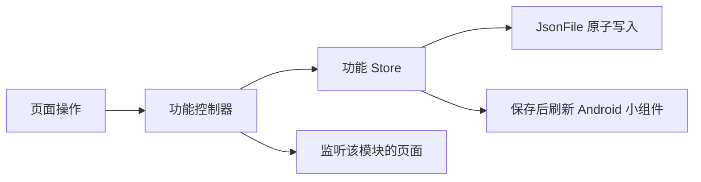

# 代码结构与数据流

各功能放在同名目录：`schedule`、`agenda`、`academics`、`classrooms`、`school`、`mooc`、`sync`、`wencui` 和 `updates`。功能的页面与表单位于各自的 `ui/`；跨功能控件、主题和动效位于 `lib/ui/`。通用异步、文件和平台访问位于 `lib/core/`。

`main.dart` 创建依赖。`AppController` 只负责组合功能模块和启动流程；`AppSettingsController` 独立管理明暗模式、语言、调色板、系统调色板和日程视图偏好。各功能控制器拥有自己的状态，页面通过 Flutter 的 `ListenableBuilder` 监听所需模块；功能更新不会经过根控制器转发给整个应用。

`core/time.dart` 是校园墙上时间、日历日期和星期起点的唯一入口。课表日期、日程、截止时间、空教室和界面格式都使用这一套 UTC 日历表示，避免夏令时和本地时区改变周次计算。`schedule/section_times.dart` 只保存节次开始与结束时间，课表模型、ICS、空教室和时间轴从这里读取，不再各自维护节次表。

需要保持提交顺序的异步操作使用 `core/async/serial_queue.dart`。队列只串行化写入本身，单个操作失败不会阻断后续操作；日程合并、课表修改、MOOC 生命周期、诊断日志和应用设置写入共享这一机制。调色板写入另用请求序号丢弃过期的系统调色板读取结果，避免快速切换开关时旧值覆盖新值。

## 国际化

界面文案由 Flutter gen-l10n 管理。`l10n.yaml` 以 `lib/l10n/app_en.arb` 为模板，与 `app_zh.arb` 一并生成 `app_localizations*.dart`；新增或修改文案后运行 `flutter gen-l10n`。页面通过 `context.l10n` 读取文案，不在控件中直接写用户可见字符串。仅用于解析学校数据、匹配楼栋名称或写入既有 JSON 的来源值保留原格式，显示时再交给本地化 helper。

`lib/l10n/formats.dart` 集中处理日期、星期、周次、节次、学分及来源枚举的显示，保证课表、日程、空教室、学业和文萃地图使用同一套单位与语序。只用于组件测试、且没有 `Localizations` delegate 的页面回退到中文，完整应用始终使用 `AppLocalizations.localizationsDelegates`。

本地化展示不修改持久化标题。`agenda/details.dart` 中的 `AgendaEntryDetails` 是物理实验、MOOC 和考试详情的封闭类型，旧 JSON 缺少 `details` 时仍按原有标题与备注读取；新条目在展示时由详情生成标题和备注。用户编辑结构化条目后，编辑器把当前本地化文本保存为用户可见快照并清空 `details`，避免自动详情覆盖用户改写。`CalendarItem.stableTitle` 只用于稳定排序，不能作为展示标题。

`AppLanguage` 支持跟随系统、简体中文和 English。设置在 `SharedPreferencesAsync` 的 `language` 键中保存 `system`、`chinese` 或 `english`，启动时恢复，切换后立即重建 `MaterialApp` 文案；未保存偏好时使用系统语言，系统语言不是中文时使用英语。

## 保存和同步

课表由 `TimetableController` 管理，日程由 `AgendaController` 管理，学业数据由 `AcademicController` 管理。页面提交操作，控制器先保存，再发布新状态；存储失败时保留原状态。学业读取使用 `LatestRequest`，切换账号后，旧读取不会覆盖新账号的数据。



`SchoolController` 负责登录状态、同步操作、请求繁忙状态和错误反馈。成功获取课表、DDL、考试或成绩后，交给相应功能控制器合并并保存。

Android 小组件由 `TimetableWidget` 更新、由 `WidgetAgenda` 读取本地课表与日程。
整个组件共享一个打开应用的 `PendingIntent`：根节点处理标题与边缘，集合模板处理
课程、列表留白和空状态。课程行合并为单个可滚动集合项，并以列表可视高度作为最小
高度，避免 `ListView` 吞掉空白区域点击，同时保留纵向滚动。

`sync/SyncController` 只持有一轮同步的所选内容、进行状态和结果，不提供任务队列、逐项追加或任务历史。覆盖课表、考试安排、成绩、学分进度及乐学、新延河课堂、MOOC、大物实验 DDL。共享学校会话的读取顺序执行，MOOC 独立并行；开始前等待其他学校查询结束，取消等待不会中断那次查询。大物实验 DDL 在本轮课表读取结束后生成。日程导入在 `AgendaController` 内顺序合并，基于最新已保存数据构造结果，并在真正写入前再次检查请求是否已取消，避免并行平台互相覆盖或取消后写入等待中的结果。

首页和日程页共用 `SyncButton`，菜单只包含「同步全部」和「自定义同步」，不承载本地数据维护。成绩和学分进度只在各自页面提供同步入口；已删除的 DDL 只在日程页头提供恢复入口，与删除后的原位撤销共同组成恢复流程。「同步全部」默认覆盖可用的课表、考试和 DDL 来源，跳过尚未登录的 MOOC；自定义抽屉按课表与 DDL 两组勾选，主动勾选 MOOC 时可登录。同步静默开始，按钮显示加载状态，再次点击才展开「同步进度」。该抽屉只显示本轮进度、各项结果、整轮取消和重试未完成内容；重试保留本轮指定的学期，返回、收起和下滑关闭不会取消。完成或失败统一反馈一次，抽屉已展开时直接更新列表，不叠加通知遮住操作。

启动时只恢复学校登录，不同步业务数据。恢复登录和后台同步不提供交互验证回调；遇到短信或图形验证时，在获取手机号、验证码图片或发送短信前停止相关读取，并保留「需要短信验证／需要图形验证」账号状态，独立平台继续同步。用户主动重试未完成的内容或查询时可完成验证码验证；取消验证则保留同一待验证状态。

设置中的账号项显示该状态，点击「验证」后重新访问统一认证入口，即使教学中心原有 Cookie 仍有效也可触发验证。取消或连接失败时保留待验证状态，成功后恢复「已登录」；凭据失效时转为「需要重新登录」。这次检查只更新登录会话，不写入课表、日程或学业数据，不自动重放先前取消的同步操作。

`SchoolAccess` 负责认证流程。每次操作由 `SchoolConnection` 并行探测服务的校内直连和 WebVPN 入口，使用先连通的一条，并关闭另一条探测连接。探测不带 Cookie、不跟随重定向，也不执行登录或业务操作；单条探测最多等待 8 秒。选定通道出现连接故障时，至多通过另一条通道重新执行一次，不重试账号密码错误或数据解析错误。登录端点连接失败时，也会尝试另一通道，因为它可能已有有效会话。

错误处理在产生错误的模块内保留稳定类型；界面只负责本地化。例如 MOOC 的登录过期、无会话、账号读取失败、请求繁忙和保存失败由 `mooc/errors.dart` 中的 `MoocIssue` 表示，`MoocFailure` 可携带平台原始消息，`SyncResult.detail` 因此可以保留对象而不把中文错误字符串当作控制流。

每次操作重新选路，不沿用上一次的通道；取消操作会关闭探测和业务连接。日志记录并行探测、胜出通道、连接失败后的切换及目标端点，区分探测选中与失败后重试。`SchoolSession` 负责 HTTP、Cookie 与响应读取。乐学和新延河课堂仅使用可校外访问的直连入口。

`SchoolLogin` 在每个认证页面识别当前步骤：已有统一身份认证会话可能直接要求短信验证，也可能在提交密码后跳转到验证页。两个阶段共用短信验证处理，不读取短信页中不存在的密码密钥。`openService` 从服务入口跟随学校的实际登录跳转，供乐学和新延河课堂 DDL 同步共用，不假设每次跳转都带有 `service` 参数。学校业务读取与 DDL 读取在会话过期时各恢复登录并重试一次，再次过期或用户取消时结束操作。

USTC 风控采集失败时遵循学校登录页的协议：仅在风控请求出现 HTTP／连接错误，或响应不是有效 token 时，将加密的 `risk_payload` 设为 `{"error":true}`，仍保留 `riskEngine=true` 并由学校继续认证。这不是登录成功状态；密码错误、短信验证、服务回调和登录会话检查照常执行。取消、凭据存储失败和程序错误不进入此处理。采集失败的技术原因只写入日志，不单独弹出内部接口地址。`/gate` 是公开页面配置的前端资源网关，不能直接据此改写独立风控服务地址。

数据仍使用 `schedule.json`、`agenda.json`、`academics.json` 和原有 JSON 字段；凭据与 Cookie 仍使用原有系统安全存储。DDL 同步保留本地编辑、删除标记和已完成状态，并接收平台完成状态。删除 DDL 时先提供原位撤销；离开当前视图后，可从日程页头的「已删除的 DDL」批量恢复。恢复不会出现在同步菜单中。

四个 DDL 来源统一在自定义同步中选择，不再占据顶层菜单的四个入口。`SchoolController.importDeadlines` 的可选 `source` 用于所选学校平台，省略时依次处理乐学与新延河课堂，保留逐平台错误处理、取消和登录状态修复。MOOC 使用独立的账号和控制器，不进入学校认证流程。大物实验为本地操作。

## 大物实验 DDL 与分类清空

大物实验 DDL 包含在「同步全部」中，也可通过自定义同步单独选择；单独同步时是本地操作，不触发学校登录。不会在应用启动或只同步课表时自动执行。生成器 `agenda/physics_lab_deadlines.dart` 遍历当前选中学期中有效周数内的每次课程：地点 `room` 同时包含「物理」和「实验」才匹配，缺少星期、节次或周次的课程跳过。课程名称去除首尾空白后按空白拆分，第一段记为 A，两种标题分别为「预习报告 A」和「实验报告 A」。

每次匹配的课程生成两项：预习报告截止于课程起始节次的开始时间；实验报告截止于课日加六天的 23:59，即下周同一星期的前夜。日期沿用校园时间的 UTC 墙上时钟约定。ID 由学期、课程 ID、上课日期和报告类型组成，重复更新不会叠加同一条记录。每次导入统一采样一次校园时间：仅首次导入且截止时间严格早于该时刻的条目自动标为已完成；同 ID 条目已经存在时，无论是否逾期都保留原完成状态，包括已删除记录。自动生成项 `source=null, local=false`，用户编辑后沿用编辑器的 `local=true` 保护机制；更新保留本地编辑、完成和删除状态，保留已完成历史与删除标记，仅移除当前学期不再匹配、且没有编辑/完成/删除状态的旧生成项。

设置页仅保留一个「删除 DDL」入口，弹窗通过复选框分别选择手动创建、大物实验、乐学、新延河课堂和中国大学MOOC 五个互斥来源，也可全选。手动创建按 `source==null` 且不是实验生成 ID 判定；大物实验按 `isPhysicsLabDeadline` 判定，编辑后仍保留其来源分类。分类不依赖表示编辑保护的 `local` 标志。

弹窗默认不选中任何来源，显示各来源和合计数量，包含所有学期、已完成与已删除记录，删除前明确提示不可撤销，不影响活动和考试。最终点击提交时校验所显示的条目 ID 集合是否仍一致；多选来源在一次写入中删除，避免分组删除造成部分成功。清空后相应平台可再次同步，课表生成项可在日程页再次手动生成。所有修改仍由 `AgendaController` 先写入同一份 `agenda.json`，成功后再通知界面和小组件。

## 课表高度

设置首页的「课表高度」提供「适应屏幕／正常高度」，即使尚未导入课表也可选择。`AppSettingsController.timetableHeightMode` 使用独立的 `ValueNotifier`，以 `timetableHeightMode` 键保存 `fit` 或 `normal`；缺失或无效值回退为正常高度。启动读取不会覆盖本次运行中已作出的选择，快速切换的写入按顺序保存。

正常高度保留原有舒适行高和接近一屏时的 90% 压缩容差。适应屏幕只将日期表头下方的实际可用网格高度平均分配给所有节次，不改变七列宽度、课程时间或系统文字缩放。课程块、时间线、进度填充和节次命中仍使用同一行高。紧凑行按空间减少文字信息，完整信息保留在详情和无障碍描述中。

适应模式不自动滚动跟随时间，也不产生纵向滚动；切换模式在布局完成后调整滚动位置，返回正常高度时恢复并限制此前位置。窗口高度和字体改变时重新计算适应行高。

## 日程视图

日程页提供列表与横向多泳道时间轴，共用类型筛选，读取同一个 `AgendaController`，不混入课表课程。列表保留未完成／已完成分页；时间轴将两种状态同表排布，不按完成状态分配泳道，已完成或已结束条目仍沿用弱化样式。视图模式通过 `SharedPreferencesAsync` 的 `agendaViewMode` 保存，缺省为瀑布图（时间轴），已有有效偏好仍按用户选择恢复；缩放和浏览位置不写入日程文件。切换视图保留本次浏览位置，离开日程页后再进入会将时间轴定位到今日 12:00 居中。

`agenda/timeline_layout.dart` 负责显示区间与泳道分配：普通日程和考试的条目保留真实起止时间，显示宽度至少为固定 2 逻辑像素，不随字体缩放改变；过窄时不强行显示卡内文字，仍可通过点击详情或悬停／长按预览查看完整信息。界面按当前缩放将最小宽度换算为时间跨度，布局通过 `layoutEnd` 同时约束绘制、可见区域筛选和泳道避让。显示范围相交的条目分入不同泳道，缩放或窗口宽度改变时可重新排布；单纯平移或字体缩放不改变这一最小宽度和横向占位规则。DDL 始终按 `[dueAt - 4 天, dueAt]` 分配泳道，原有渐变宽度不变。两类显示占位都不会修改条目的真实时间或写入模型。

`AgendaTimelineEntry` 只负责条目的外观和交互，不处理坐标或泳道。日程与考试在标题下常驻真实起止时间，跨天时分两行标出日期；全天日程显示日期范围。DDL 保留课程／来源，并另列截止时间。长按或鼠标悬停显示包含开始、结束或截止日期、课程及地点的分行预览；点按沿用详情抽屉。卡片最小高度为 56 逻辑像素，并随字体放大，确保完整时间与来源信息有独立空间。

DDL 绘制与布局分离：右端为 `dueAt`，左侧渐隐，屏幕宽度为当前窗口最小缩放时的 3.75 天，即 `cellWidth × 3.75`（180～315 逻辑像素）。该宽度不随缩放变化，窗口变化时可更新；可见条始终包含在四天布局区间内。按实际绘制宽度裁剪条目，短条目的扩展点击区域不会越过同泳道下一条目的布局起点。全天 DDL 的右端沿用模型定义，为对应日期次日零点。

时间轴以视口中心时间和连续缩放比例计算坐标，不创建覆盖历史与未来的巨大滚动画布。默认一天一格，最多一小时一格；基准格宽为 48～84 逻辑像素。平移没有预设日期边界，只绘制可见区域附近的网格和条目。顶部工具栏只保留单行并排的「今天」按钮与自适应宽度的缩放滑条，不显示当前日期和常驻的「时间/格」文本，缩放比例仅保留无障碍语义描述。表头基准高度为 24 逻辑像素：不显示小时时，第一行显示日期、第二行居中显示星期；显示小时时，第一行将「日期 星期」作为一个整体居中，第二行显示小时。标签宽度测量包含完整星期与中间空格，固定在对应时间格的中上方，以完整文字绘制并在视口边缘自然裁切，不贴靠屏幕边缘或变成省略号。首个日程条距表头分隔线 12 逻辑像素，与日程条之间的轨道间距一致。工具栏不再包含问号帮助图标及其提示。当前时间线单独在前景绘制，覆盖日程条但不拦截交互，也不绘制圆点。条目单击复用日程详情弹层，编辑、删除、同步后由功能控制器通知刷新。

时间轴使用独立的语义色，不复用楼栋调色板。考试、大物实验 DDL、乐学 DDL、新延河课堂 DDL 和 MOOC DDL 分别使用黄、蓝、橙、紫和薄荷绿，且每种颜色直接定义浅色与深色的 `fill`、`text`、`accent`。背景使用 fill、文字使用 text、DDL 右侧条与其他日程边框使用 accent。未完成且逾期的 DDL 沿用普通 DDL 的左淡出卡片样式，将 fill 替换为 errorContainer、文字替换为 onErrorContainer、强调色替换为 error；背景右侧再以 20% onErrorContainer 绘制大号警告图标虚影，来源色和错误色不进行长距离混色。末尾直接显示截止时间与“已逾期”。完成该条目后移除红色状态与虚影，并恢复来源色的淡化样式。已完成 DDL 和已结束考试的背景、文字、图标及边框／右侧条统一使用 50% 不透明度（50% 透明），保留各自原色；普通活动的完成样式不变。列表和课表不使用这套映射。

主页课表网格中的日程块不复用时间轴的语义来源色：普通活动使用 `primaryContainer` 背景、`onPrimaryContainer` 文字和 1px `primary` 边框，考试使用 `errorContainer`／`onErrorContainer`／`error`。浅色模式下容器色与页面底色天然接近，可见性由 tone 固定的边框和文字承担，因此开启全局系统调色板后仍能辨认；不使用 `outlineVariant` 等低对比细分隔色。

关闭全局系统调色板时，所选 JSON 调色板只覆盖课程与普通日程块，不修改页面背景、全局 `ColorScheme` 或应用明暗模式。内置 Mocha／Macchiato／Frappé 位于 `assets/palettes/`，颜色来自 [Catppuccin palette](https://github.com/catppuccin/palette/blob/main/palette.json)，均适用于深色模式。课程使用所属区域的强调色，普通日程使用 `agenda`；最终底色统一为 `Color.lerp(base, accent, 0.24)`，文字统一使用 `text`。主页普通日程块与时间轴普通活动、无平台来源的手动 DDL 使用同一组颜色。时间轴中的平台作业、MOOC、物理实验与考试继续保留来源映射；未完成且逾期的 DDL 使用轻量错误色蒙版，主页考试沿用错误色，完成淡化规则不变。系统调色板可用且已启用时优先于 JSON 配色。
设置的「外观」二级页面提供明暗模式切换、浅色／深色调色板独立选择、JSON 文件导入、自定义配色的删除按钮及系统调色板开关，所有选项均可直接使用。关于弹窗中的五次连击仍可开启本次运行的开发者模式，但目前不影响任何功能。导入成功后将完整配色内容复制到应用设置并应用到对应模式，不依赖原文件继续存在；校验或保存失败时保留原选择。删除正在使用的自定义配色会将对应模式恢复为默认。旧版本的 Cat 配色选择会自动恢复。Android 小组件接收浅色和深色课程的最终颜色，其系统课程配色开关仍独立控制；Android 12+ 的组件整体背景与文字继续使用系统颜色。文件格式与字段说明见 [调色板文件](palettes.md)。

操作方式：拖动或普通滚轮横向浏览时间，双指捏合、`Ctrl + 滚轮` 或滑条连续缩放；上下拖动或 `Shift + 滚轮` 浏览泳道。时间轴隐藏显式与桌面自动添加的纵向滚动条，仍保留纵向滚动和惯性。单指或鼠标拖动释放后，使用 Flutter 的摩擦物理模拟继续滑行；缩放、新输入、隐藏视图或离开页面时停止惯性，触控板自身的惯性输入不额外叠加甩动。「今天」按钮回到今日居中。日程列表的完成状态以分段选择过滤，不使用横向分页；时间轴的横拖只用于时间导航。

## 中国大学MOOC

`MoocController` 独立管理 MOOC 账号、当前请求与同步结果。`ui/login.dart` 通过 `webview_all` 在应用页面中内嵌官方登录页。浏览器在 MOOC 来源内读取已登录的 `webUser` 账号字段和真实 User-Agent，原生 Cookie 管理器导出适用于 `/web/j/` 的会话，再交给控制器保存到安全存储。网页的 JavaScript 对象由浏览器执行后转换为普通数据，Dart 不再抓取 HTML 或解析服务端脚本。Cookie 导入先写入同一浏览器，再打开官方个人中心确认账号，复用相同的登录完成流程。只有保存会话时才显示忙碌状态；读取失败停止轮询，用户可刷新或重试，不反复显示验证提示。密码只由官方页面处理。

`MoocApi` 只请求固定 HTTPS 来源的读取接口，不跟随认证重定向。Cookie 的域、路径、到期与服务器轮换由 `cookie_jar` 管理，请求前按路径长度排列同名 Cookie。同步使用保存的会话分页读取 `courseType=1/2` 的全部课程，再通过 `getLastLearnedMocTermDto` 读取包含个人提交记录的课程学期 DTO。`tasks.dart` 区分提交与学生互评截止；有效提交次数、已提交状态或已有得分均可确认提交完成，不等待最终评分，也不把逾期视作完成。互评通过 `getEvaluateStatus` 的 `stepEvaluated` 单独确认；老师批改不会生成互评任务，考试使用主观题编号查询互评。任务编号包含账号、学期、任务类型与阶段，交给 `AgendaController.mergeDeadlines` 更新远端完成状态并保留本地编辑、完成与删除状态。某门课程的结构或互评读取失败时，不导入该课程的部分结果，并显示课程名和原因；接口报告会话过期或请求取消时，不保存任何部分导入结果。应用启动只读本机会话，不自动发起 MOOC 登录或同步。

账号抽屉只处理登录、Cookie 回退与退出。课表、日程和学业页面使用 `sync/ui/sync.dart` 发起同步，MOOC 与学校来源共用本轮进度抽屉；会话过期时通过重试重新登录，取消登录则保留本轮结果。独立的 MOOC 同步弹窗和页面销毁时取消请求的路径已移除。

`MoocCookie` 在浏览器导出、持久化恢复和 HTTP 响应轮换处使用同一转换方式，原样保留浏览器接受的逗号、引号等值，不重新编码会话。名称与属性仍由 Dart 解析，域、路径和过期策略仍由原有 Cookie 管理器执行；值中拒绝控制字符和分号，防止改变请求头或 Cookie 边界。安全存储的字段和格式不变。

更新检查把发布说明解析为 `updates/release.dart` 中的 `AppReleaseNotes`：Markdown、提交列表、无变化和不可用是不同状态，界面不再猜测字符串格式。提交比较只读取首尾分页并保留总数，详情链接仍是 HTTPS GitHub 地址。

接口字段依据官方个人中心的 `home/desktop/modules/course/index.html`、`spocCourse/index.html` 及其脚本，以及公开课程 `courseBean.getMocTermDto.rpc` 的实际响应。登录验证码与风控都由平台官方页面完成。

## 空教室查询

页面只负责显示控件、日期选择和登录验证界面。`ClassroomController` 管理查询输入、结果和取消：更换校区或日期会取消旧查询，等待其资源结束后执行新查询；教学楼和时段筛选直接复用已获取的数据。

`ClassroomRepository` 持有教室数据缓存。同账号的教学楼目录缓存一天，占用情况缓存五分钟；相同查询共享进行中的请求。切换账号或退出登录会清空缓存，刷新目录也会清空占用缓存。取消或失败的结果不会缓存。

## 手势与布局

- `SwipePager` 统一鼠标与触摸分页，拖过半页即报告新页，程序切页不报告中间页。
- `SwipeActionTile` 以明确的横向意图接管单条操作，不增加按住等待。短滑露出按钮，长滑达到阈值后松手执行；左滑删除，右滑完成或恢复 DDL。快速收回和反向拖回都可以取消。`TapRegion` 处理外部触摸收起，最近的纵向 `ScrollPosition` 处理滚动收起，不额外维护全局打开条目。滑出、按钮停靠与回弹共用动画，保存失败回到原位。行的增删尺寸动画由 `AnimatedSliverChildren` 统一处理。
- `PullToRevealList` 管理下拉手势和展开状态，`RevealScrollController` 在布局阶段同步内容高度与滚动位置。用户重新拖动时解除滚动保持，直接接管滚动。
- `AppMenuAnchor` 使用原生 `RawMenuAnchor` 管理焦点与菜单生命周期，统一面板的开合动效。菜单高度取触发器上下的实际可用空间。
- `SheetLayout`、`EditorSheet` 和主题共同约束弹层尺寸、固定操作区与可滚动内容。地图的缩放、绘制和命中测试由 `WencuiFloorMap` 管理。

## 验证

`test/support/test_app.dart` 使用真实功能控制器，只将存储和平台边界替换为内存实现。测试覆盖菜单、滑动、展开与收回、不同窗口和字体大小、请求取消、同步合并、账号切换以及真实文件存储格式。

```sh
dart format lib test
flutter analyze --no-pub
flutter test --no-pub
```

架构划分参考 [Flutter 官方建议](https://docs.flutter.dev/app-architecture/recommendations)、[Compass 的数据层](https://github.com/flutter/samples/tree/main/compass_app/app/lib/data) 和 [Wonderous 的功能状态组织](https://github.com/gskinnerTeam/flutter-wonderous-app/tree/main/lib/logic)，具体边界按本项目的离线存储和学校登录流程确定。
