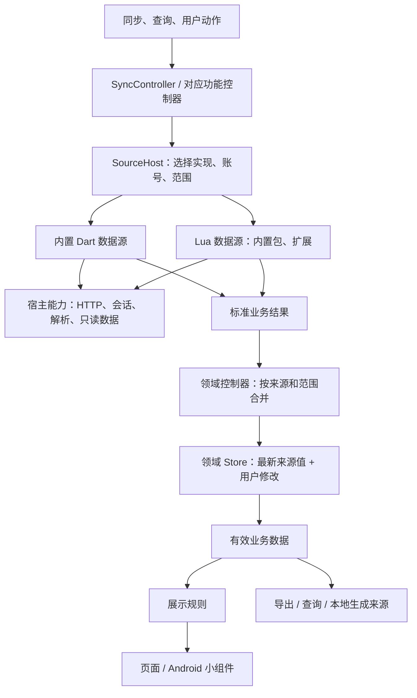

# Lua 数据源与自动化扩展设计

设计稿，2026-11-09。依据 `feat/luautomation` 分支，读取时 HEAD 为 `2428bc6ef909fc851499ae0138b85fe5c749255c`。本文定义拟实现的行为和 API；示例中的新 API 尚未实现。本文目前放在 `main` 的工作区，而 `lib/automation` 等展示规则代码只在该分支中，文中提到的这些路径在 `main` 上还不存在。

目标是让内置平台和用户 Lua 扩展使用同一条数据接入路径：用户能补充平台漏掉的课程、接入新平台、修正现有接口、生成本地数据，以及调整展示。平台中自行加入的课程和 BITree 本地手动创建的课程都必须覆盖。

当前实现进度：C Lua + FFI、协程异步宿主调用、基础 `ctx.http` 传输已经接通；内置 Dart 与 Lua 来源统一经 `SourceRuntime` 分派，Dart 来源已可发现课程、解析手动补课并按课程读取 DDL。设置首页的“数据来源”与账号同组，扩展在该页安装和卸载，装上即生效；“同步全部”遵循来源的启用状态、课程选择和所选实现。显示规则的快捷设置由预置 Lua 模块 `bitree.display` 执行，并与自定义脚本叠加。内置平台 Lua 包、账号会话复用和五平台打包仍按 §12.2 继续推进。

保留现有 Flutter 界面体系、离线使用方式、学校直连/WebVPN、账号验证、用户编辑与删除恢复能力。平台协议由数据源实现；数据身份、合并保存、账号授权和用户交互由宿主管理。

## 1. 必须完成的实际场景

| 场景 | 用户操作 | 系统行为 |
| --- | --- | --- |
| 乐学或 MOOC 漏掉自行加入的课程 | 在该来源的课程清单中添加课程链接或编号 | 使用该来源的账号解析课程，加入后续同步范围 |
| 一批课程需要从另一接口发现 | 为现有来源选择 Lua 实现 | 替换课程发现步骤，继续使用原有作业读取 |
| 某接口改了参数或返回字段 | 安装针对该来源的修复扩展 | 覆盖指定的请求或解析步骤，复用其余步骤 |
| 平台整体换了一套接口 | 替换相关业务操作，或添加新来源 | Lua 负责请求、分页和解析，宿主负责数据合并 |
| BITree 中手动添加的课程也有网上作业 | 将平台课程关联到本地排课记录 | 作业按稳定课程引用关联，课程名称变化不破坏关联 |
| 根据本地课程生成预习、实验报告等 DDL | 启用本地生成来源并同步 | 读取包含手动课程的有效课表，生成可编辑、可完成的持久记录 |
| 批量修正本地课程或日程 | 从相应页面运行扩展动作 | 展示修改结果，确认后作为用户编辑保存 |
| 只想隐藏旧平台重复任务或改显示名称 | 启用展示规则 | 处理展示副本，停用规则后恢复有效数据的展示 |

“新增数据源”与“修复现有数据源”必须是正常入口。前者有自己的数据身份；后者沿用原来源实例的数据身份，避免修复一次就重复导入一份数据。

## 2. 结构与职责



只引入满足当前需求的四个概念：

| 概念 | 内容 | 例子 |
| --- | --- | --- |
| 扩展包 `ExtensionPackage` | Lua 文件、声明、设置字段、动作和显示名称 | 某同学编写的乐学补充工具 |
| 数据源定义 `SourceDefinition` | 支持的业务操作、登录方式、默认设置 | 内置乐学、外部 Moodle、课表生成 DDL |
| 来源实例 `SourceInstance` | 一个定义与账号、配置、同步范围的绑定 | 我的乐学、我的某课程日历 |
| 账号 `Account` | 身份、受保护凭据及会话 | 学校统一认证账号、MOOC 账号 |

`SourceHost` 是源操作的入口，负责实施授权、调用、取消与错误传递，不保存课表或日程。`TimetableController`、`AgendaController`、`AcademicController` 继续拥有各自的数据和写入。查询结果由对应 repository 管理。

内置 Dart 实现和 Lua 实现遵循相同业务契约。新增来源不修改 `SyncTarget` 或 `DeadlineSource` 枚举，不往页面增加平台名称分支。

乐学、新延河课堂和 MOOC 的业务读取改写为随应用发布的内置 Lua 来源包；登录、会话、Cookie 和直连/WebVPN 选路仍由 Dart 实现。修复扩展继承内置包，覆盖其中的操作或具名步骤（§6.3），不给 Dart 请求增加请求/响应钩子。教学中心的课表、考试、成绩、培养方案、空教室以及大物实验生成暂时保留为内置 Dart 来源，经同一 `SourceHost` 契约调用；是否改为 Lua 在第 5 阶段决定（§12.2）。

不增加后台任务服务器或持久任务队列。一次同步仍是当前进程内的一组异步操作。

## 3. 数据身份、编辑和同步范围

### 3.1 来源身份

每个来源实例拥有持久 `sourceInstanceId`，绑定一个账号身份或本地数据范围。每种资源中的远端记录使用 `remoteId`；唯一键为：

```text
(sourceInstanceId, resource, remoteId)
```

`resource` 使用固定的业务类型，如 `timetable`、`deadline`、`event`、`exam`、`grade`、`studyPlan`，不使用操作名称。同一 DDL 经 `agenda.read` 与 `deadlines.read` 读到时仍属于 `deadline`，使用同一个身份。新增来源不增加业务类型；真正新增产品功能时才增加对应领域类型。平台课程清单不是领域记录，不在这些类型中，与手动补充、同步开关和课程关联一起保存在来源实例里（§4）。

账号有变化时使用另一来源实例；重新登录同一个经过验证的账号可以继续使用原实例。退出登录不会删除离线数据。修复扩展接管现有来源实例时，保留上述唯一键。

平台编号一律用字符串。来源实现负责使用真实稳定的远端编号；名称、教室、截止时间、数组下标不能充当新的稳定编号。上游只有学期内编号时，将学期编号纳入 `remoteId`。同一平台的日历和课程接口指向同一任务时，由该平台实现归一到同一个编号。

跨平台的记录默认各自保留。用户可明确关联课程、选择来源或用展示规则隐藏重复项；宿主不按标题和时间猜测它们是同一记录。

宿主内部记录 `id` 与远端编号分开。已有记录保留现有 `id`，避免编辑器、删除标记和其他引用失效。来源归属是同步所需字段，不建立记录历史、哈希或执行凭证系统。

### 3.2 保存最新来源值和用户修改

当前 `Course.local` 同时表示手动添加和修改过的同步课程；日程也用 `local` 保护整条记录。新设计把这些含义分开。

概念上的持久结构如下，具体 JSON 按领域类型实现：

```text
Record
  id
  origin?       = { sourceInstanceId, remoteId, scope }
  data          = 最新来源字段；手动记录则为用户输入
  overrides     = 用户修改过的字段及其值
  userState     = 删除标记、完成状态覆盖等本地状态
```

有效数据由 `data` 应用 `overrides` 和 `userState` 得到，不再保存第二份完整的有效记录。这里保存最新来源值，是为了在同步时保留用户修改并支持“恢复来源值”。

合并规则：

| 操作 | 结果 |
| --- | --- |
| 用户只修改同步 DDL 标题 | 只固定标题；后续截止时间、课程等仍接收来源更新 |
| 用户修改截止时间 | 固定时间字段组，详情中可恢复来源值 |
| 手动新增课程或日程 | `origin=null`，普通同步不会删除或接管它 |
| 用户标记 DDL 完成/未完成 | 保存明确的本地覆盖；“跟随平台”清除覆盖 |
| 来源返回完成状态未知 | 保留上次来源状态，不把未知当作未完成 |
| 用户删除来源记录 | 保留隐藏/删除标记，重复同步不会使其重现 |
| 来源移除了有本地修改的记录 | 保留有效记录并标记来源已移除，供用户保留或删除 |
| 停用来源/卸载扩展 | 保留已导入记录；停用展示规则只影响显示 |

`done`、`deleted`、内部 `id`、来源归属不能由普通数据源输出伪造。来源输出 `completion = "done" | "pending" | "unknown"`，由宿主与本地状态合并。

相互约束的字段成组覆盖。否则用户改了开始时间、平台又改了结束时间，合成结果可能结束早于开始，记录无法构造：

| 记录 | 字段组 |
| --- | --- |
| DDL、活动、考试 | `startsAt`、`endsAt`、`allDay` |
| 课程 | `weekday`、`startSection`、`endSection`、`weeks` |

用户修改组内任一字段时固定整组，“恢复来源值”也按组恢复；其他字段单独覆盖。

字段级覆盖要求来源记录有稳定的 `remoteId`。乐学、新延河课堂和 MOOC 的 DDL 有真实远端编号，首版在这些 DDL 上使用字段级覆盖。学校排课和考试的现有 ID 由名称、教室、时间等内容拼接，平台一调整就成为另一条记录，固定某个字段后没有可以继续接收更新的目标。确认学校接口返回稳定 ID 之前（§13 事实 1），课表和考试按整条记录覆盖：用户编辑过的同步记录整体固定；同一 ID 再次出现时仍更新 `data`，供“恢复来源值”使用；平台改动内容后，旧记录按“来源移除了有本地修改的记录”处理。

### 3.3 导入范围与缺失记录

每次业务调用由宿主固定来源实例、资源和作用范围。脚本返回的结果只能更新该范围。

| 资源 | 典型范围 | 默认合并 |
| --- | --- | --- |
| 课表 | 来源实例 + 学期 | 完整结果替换该来源在该学期的排课；保留用户修改 |
| 考试 | 来源实例 + 学期 | 同上；不删除其他来源的考试 |
| 成绩 | 来源实例 + 账号所选学期或全部学期 | 仅完整读取才替换对应范围 |
| 培养方案 | 来源实例 + 账号/方案 | 替换该方案，保留用户学分目标和分类修改 |
| DDL / 外部日程 | 来源实例 + 课程或订阅 | 默认增量合并；未返回不等于已删除 |
| 本地生成记录 | 来源实例 + 学期 | 可完整替换本来源生成项；保留编辑、完成和删除状态 |
| 空教室 | 来源实例 + 日期/楼栋等查询 | 返回查询结果，不写入个人日程 |

集合读取返回：

```lua
return {
    items = { ... },
    mode = "upsert", -- 或 replace
    removed = { ... }, -- 明确删除的 remoteId；可省略
}
```

`replace` 只能用于声明支持完整覆盖的操作，范围仍由宿主确定。分页未完成、读取失败、权限不足不能伪装为空集合。正常空集合与读取失败必须有不同结果。

学习平台通常按课程读取 DDL。成功课程可以合并，失败课程保留旧数据。平台日历等可能重叠的读取使用增量合并；不通过缺失推断删除，避免重叠范围互相删除记录。

## 4. 课程发现与手动补充

平台课程清单是独立资源，包含 `remoteId`、名称、课程链接、可选远端学期编号及该平台后续请求必要的标识。它与课表排课记录分开：一个网上课程可以没有排课，也可以对应多条排课。

一次学习平台同步按以下顺序执行：

1. `courses.list` 获取平台自动发现的课程。
2. 合入用户手动添加的课程，按同一来源的 `remoteId` 去重。
3. 应用用户对课程的同步开关。
4. 按有效课程调用 `deadlines.read`，或该来源声明的其他课程级读取。
5. 来源声明了账号级读取 `deadlines.readAccount` 时，调用一次并传入有效课程清单；宿主丢弃归属于未选课程的条目。
6. 汇总成功课程的数据和失败课程的错误，再合并保存。

账号级读取只用于平台按账号而不是按课程提供的数据，例如乐学的日历导出。它返回的每项必须带 `courseRef`，或明确标为不属于任何课程；后者（个人或全站事件）不受课程选择影响。同一轮中课程级与账号级读取返回同一 `remoteId` 时，宿主合成一条记录：其他字段取课程级结果，完成状态按 `done`、`pending`、`unknown` 的顺序取较前者。

乐学按这一规则实现：

- `deadlines.read` 只扫描该课程的课程页，`remoteId` 为 `cm:<课程模块编号>`。
- `deadlines.readAccount` 读取日历导出，用日历事件详情接口把条目归到课程和课程模块（§13 事实 5）。能得到模块编号的条目使用同一个 `cm:` 编号，与课程页结果合为一条；其余条目使用 `event:<日历事件编号>`。
- 现有通过接口查询补充完成状态的逻辑留在这两项读取内部。

用户的手动课程、同步开关和课程关联保存在来源实例中。自动发现结果也保存在这里，保留最近一次成功的完整清单，供离线显示和发现失败时继续使用。自动发现结果后续包含同一课程时，只显示一条；再次从自动清单消失时，手动添加仍然有效。

自动发现发生普通网络或解析错误时，界面保留旧清单并显示错误，仍可读取已有明确选择和手动加入的课程；不把旧清单伪称为刚发现的结果。账号过期或验证要求仍停止该账号的读取。手动补充不依赖自动发现成功。

“添加课程”接受链接或编号，调用 `courses.resolve` 验证并补齐名称、学期和后续请求所需标识。特殊平台需要多个编号时，通过该来源声明的小表单提供，例如 MOOC 的课程编号与开课期次。无法验证时保留输入并显示原因，不猜造期次、不把登录失败保存成课程。

“关联本地课程”允许一个平台课程关联多条本地排课记录，也允许一条本地排课关联多个平台课程。引用保存内部记录 ID，名称只作展示。后台同步不根据名称建立关系。

关联的用途：本地课程详情列出所关联平台课程的 DDL；DDL 详情显示对应的本地课程并可打开；本地生成来源通过 `ctx.data.courseLinks` 读取。§13 事实 1 解决之前，学校排课 ID 会随平台调整而变化；关联的排课被来源移除时，课程详情提示重新关联，不按名称自动接上。

本地手动课程进入 `ctx.data.courses` 和 `ctx.data.courseOccurrences`，与已经应用本地修改的同步课程一起提供给生成来源。读取不经过展示规则，以免隐藏、改名等显示操作影响持久数据生成。

取消勾选课程仅停止后续读取。删除其已导入 DDL 是单独的明确操作。移除关联也不删除任一侧课程。

## 5. 扩展包与实现选择

扩展包使用含 `manifest.json` 和 Lua 源文件的目录或 ZIP。安装时先读取声明，再显示能力与来源；确认安装后才运行代码。`require` 可加载宿主保留的 `bitree.*` 模块和本包 Lua 模块。宿主检查路径穿越、符号链接及解压大小，运行时只加载文本脚本。

一个声明示例：

```json
{
  "id": "personal.eclass-fixes",
  "name": {"zh": "延河课堂补充", "en": "Eclass additions"},
  "version": "1.0.0",
  "apiVersion": 1,
  "sources": [
    {
      "id": "eclass",
      "name": {"zh": "延河课堂补充", "en": "Eclass additions"},
      "extends": "builtin.bit.eclass",
      "baseVersion": "1.0.0",
      "entry": "eclass.lua"
    }
  ],
  "permissions": {
    "network": ["https://zy-eclass.bit.edu.cn"],
    "sessions": ["bit.eclass"]
  }
}
```

完整来源声明自身的 `operations`、`auth`、`settings`；继承来源仅声明覆盖项和新增能力。`extends` 首版指向随应用发布的内置 Lua 来源包，支持单层继承。一个来源实例同时选择一个实现，不叠加任意数量的拦截器。

`permissions.sessions` 填账号服务名称，如 `bit.lexue`、`bit.eclass`、`icourse163`。服务名称由宿主账号服务定义，与来源定义 ID 分开，多个来源可以使用同一服务的会话。

声明中的 `operations` 是可用能力清单；Lua 入口的 `operations` 是函数实现。启用时校验两者匹配；继承来源将内置能力与覆盖项合并。来源定义的全名由包 ID 和包内来源 ID 组成，来源实例 ID 则始终由宿主创建。

`apiVersion` 表示宿主公开 SDK 的主版本，安装/启用时检查一次。破坏外部脚本契约的变化需要新主版本；内部 Dart 重构不增加兼容分支。展示规则的 `filter(data)` 只存在于 `feat/luautomation` 分支，没有进入正式版或测试版（二者都只从 `main` 发布），因此直接改用新契约，不保留旧的输入格式和时间约定（§10.6、§13 事实 4）。

完整来源的声明还可以包含：

| 字段 | 约定 |
| --- | --- |
| `operations` | 操作名称及返回资源；写入范围由宿主操作决定 |
| `auth` | `none`、继承账号服务、`browser` 或 `script`，以及所需表单/登录入口 |
| `settings` | 实例设置字段；`ctx.config` 是本次调用开始时的只读值 |
| `courseInput` | 通用链接/编号不足时的课程解析字段 |
| `inputs` | 本地生成来源实际读取的资源，供同一轮同步安排顺序 |
| `actions` | `id`、名称、适用位置、输入字段、读写能力、入口函数 |

授权项包括精确网络来源、使用的账号服务、本地资源读取、本地资源编辑，以及本来源认证所需的特定 Cookie 名称；用户选取文件随文件导入在后续阶段加入。实际可用能力为包声明、用户授权和当前执行场景的交集；继承实现不能扩大授权。包更新不能自行授予新增能力。

首版限制授权组合：使用账号服务会话的包，网络授权只能是该服务自己的网站，不能同时申请其他网站；需要访问其他网站的包不能使用学校或平台账号会话。这样读取乐学数据的扩展无法把数据发往外站。扩展不再藏在开发者模式后面，在交流群里分享安装会很常见，这条限制不依赖用户逐项判断权限组合。

撤销权限会取消依赖该权限的运行并阻止尚未开始的写入，已有离线数据保留。被选中的实现报错时报告该错误；需要恢复内置实现时由用户明确切换，避免静默切换后错误地报告修复已生效。

继承内置定义的来源在首次安装时应用到对应的现有来源，保留实例 ID、账号、课程范围和数据；安装确认页事先列出会改用它的来源，用户之后可在来源详情的“实现”中改回内置实现。重新安装或更新同一扩展不改变各来源已选的实现。独立来源在安装时创建自己的实例和记录。安装本身不执行同步。

扩展更新先验证 API 版本、入口和声明，再切换实现；执行中的旧版本先完成或由用户取消。新增授权需要明确接受，已有版本继续可用。安装来源或包 ID 不作为作者身份认证。

继承来源用 `baseVersion` 声明编写时所基于的内置包版本。内置包随应用更新、版本与之不同时，来源详情显示“内置实现已更新”，由用户选择继续使用修复或恢复内置实现：修复不会被静默停用，也不会在用户不知情时继续覆盖已经修好的内置实现。启用和更新时，宿主检查修复覆盖的每个步骤在当前内置包中存在，不存在时报告错误，不静默忽略。

单文件 `.lua` 展示规则仍可导入，由宿主保存其规则名称和设置，不要求原用户改造成扩展包。运行时统一使用新的 Lua 实现。

## 6. 数据源公开 API

### 6.1 统一调用约定

Lua 入口返回一个 table：

```lua
return {
    operations = {
        ["courses.list"] = function(ctx, query)
            -- 返回平台课程数组
        end,
        ["deadlines.read"] = function(ctx, query)
            -- query.course 是本次要读取的平台课程
            -- 返回 { items = ..., mode = "upsert" }
        end,
    },
    steps = {
        -- 继承内置包时，按名称覆盖其中的请求或解析步骤（§6.3）
    },
}
```

这里只展示函数形状。扩展可以只实现需要覆盖的函数。调用是普通 Lua 函数调用；宿主异步能力在内部挂起和恢复协程，脚本作者不需要轮询任务。

`ctx.base.call(operation, query)` 调用所继承内置包的同名操作，直接进入原实现，不重新进入覆盖的操作；原实现调用的步骤使用合并覆盖后的 `steps`（§6.3）。课程发现与逐课程读取由宿主组合；原实现的某个读取函数不能私自重新发现一遍课程并绕过已选择范围。

业务读取抛出错误表示失败；返回空集合表示成功读取到零条。脚本 `nil` 返回、字段缺失和非法记录是协议错误，不自动降级为空数据。

### 6.2 操作清单

| 操作 | 输入 | 输出与用途 |
| --- | --- | --- |
| `auth.check` | 当前来源会话 | 已验证身份或需要登录/验证；不发短信 |
| `auth.login` | 当前用户发起的认证上下文 | 经过验证的稳定账号标识与显示名 |
| `auth.logout` | 当前会话 | 可选远端退出；本地撤销由宿主完成 |
| `terms.list` | 无或来源查询参数 | 学期编号、名称、可选当前学期 |
| `terms.read` | `remoteTermId` | 学期起点、周次范围；映射到本地学期 |
| `courses.list` | 可选远端学期 | 完整的平台课程清单；分页由实现完成 |
| `courses.resolve` | 用户输入的链接/编号/表单 | 一个可读的标准平台课程引用 |
| `timetable.read` | 已映射学期 | 排课记录集合 |
| `deadlines.read` | 平台课程，可选查询区间 | 该课程 DDL 集合与明确删除项 |
| `deadlines.readAccount` | 有效课程清单 | 平台按账号提供的 DDL；每项带课程引用或标明不属于课程（§4） |
| `agenda.read` | 学期或订阅查询区间 | 本地生成或外部日历的 DDL、活动等 |
| `exams.read` | 已映射学期 | 考试集合 |
| `grades.read` | 学期或明确的全部学期范围 | 成绩集合 |
| `studyPlan.read` | 当前账号及可选方案编号 | 培养方案、毕业学分要求及平台汇总 |
| `classrooms.directory` | 当前来源 | 校区、楼栋及其稳定编号 |
| `classrooms.occupancy` | 日期、楼栋/校区、节次查询 | 教室占用；未知与空闲区分 |

来源只声明实际支持的操作。同步项、筛选项和页面入口从声明生成；不支持的操作不展示为可以点击但始终报错的按钮。

首版（§12.2 第 1–4 阶段）向扩展开放 `auth.*`、`courses.*`、`deadlines.*` 和 `agenda.read`。`terms.*`、`timetable.read`、`exams.read`、`grades.read`、`studyPlan.read` 和 `classrooms.*` 的契约随第 5 阶段确定；在此之前由内置 Dart 来源直接提供，扩展不能覆盖。

学期名称由来源提供，远端学期编号映射到宿主已有学期。来源不能未经用户选择覆盖已有学期起点或周次设置。成绩与培养方案按来源分开读取；现有本校绩点规则继续由学业领域计算，数据源输出成绩事实。首版只有内置教学中心一个学业来源，多来源汇总不在本次范围内。

### 6.3 对内置来源进行小范围修复

内置乐学、新延河课堂和 MOOC 包把请求与解析拆成具名步骤，放在返回表的 `steps` 中，内置操作通过这张表调用它们。继承来源可以覆盖 `operations` 或 `steps` 中的函数：宿主先加载内置包，再把扩展的覆盖项合入同一张表，原函数保留在 `ctx.base.steps` 中，供覆盖函数调用。覆盖一个解析步骤时，课程发现、分页和其余步骤仍使用内置实现。

参数或返回字段的小变化覆盖对应步骤；分页策略或整段请求流程改变时覆盖对应业务操作。步骤名称、参数和返回值是该内置包当前版本的契约，写在包的 SDK 文档中；Dart 私有方法不是公共 API。内置包更新后按 §5 的版本检查提示用户。

来源和修复都通过 `ctx.http.request` 发出请求，执行顺序固定为：

```text
构造逻辑请求 → 检查授权与参数
→ 选择直连/WebVPN、附加该服务会话 → HTTP
→ 逐跳检查重定向 → 更新 Cookie → 返回给脚本解析
```

脚本看到逻辑目标 URL、最终 URL、状态、普通响应头和受大小限制的正文。Cookie、Authorization 等宿主凭据不出现在脚本可见的请求头或响应头中；重定向、会话恢复和凭据处理由传输层管理。

WebVPN 由宿主把已授权的逻辑站点转换为实际传输地址，同时检查跳转目的地。授权不能仅检查 WebVPN 域名，否则同一网关路径可能指向另一个未授权站点。Cookie 的域、路径、过期和安全属性继续由 CookieJar 实施。

认证流使用单独的认证操作和授权，普通业务读取不能截获学校密码、短信提交或统一认证响应。需要更改认证协议时覆盖 `auth` 操作并声明相应权限。

### 6.4 标准结果字段

公共 SDK 使用明确数据类型，边界校验一次后转为 Dart 领域对象。

| 类型 | 必填字段 | 主要可选字段 |
| --- | --- | --- |
| `RemoteCourse` | `remoteId`, `name` | `url`, `remoteTermId`, 平台专用的结构化 `params` |
| `Term` | `remoteId`, `name` | `firstMonday`, `firstWeek`, `lastWeek` |
| `TimetableEntry` | `remoteId`, `name` | `number`, `teacher`, `room`, `campus`, `description`, `weekday`, `startSection`, `endSection`, `weeks`, `courseRef` |
| `Deadline` | `remoteId`, `title`, `dueAt` 或 `dueDate` | `courseRef`, `course`, `notes`, `location`, `url`, `completion` |
| `Event` / `Exam` | `remoteId`, `title`, 开始与结束 | `courseRef`, `course`, `location`, `notes`, `url` |
| `Grade` | `remoteId`, `name`, `termRef`, `credits`, `result` | `number`, `attribute`, `category`, `examType` |
| `StudyPlan` | 方案标识或当前账号唯一方案 | `major`, `year`, `requiredCredits`, `completedCredits` |
| `ClassroomDirectory` | 校区与楼栋数组 | 楼栋到校区的引用 |
| `ClassroomOccupancy` | `roomId`, `name`, `date`, 占用节次 | `buildingRef`, 数据状态 `known/unknown` |

`TimetableEntry` 对应当前 `Course` 的一条排课记录；暂不为同名课程引入新的课程聚合存储。平台课程可通过关联指向多条排课记录。`courseRef` 可引用该实例发现、解析或由用户关联的平台课程；本地生成来源也可引用本次获授权读取返回的 `localId`。内部记录 ID 由宿主提供，不能靠猜测 ID 读取其他数据。

`agenda.read` 的结果可以混合 DDL 与活动，每项用 `kind = "deadline"` 或 `"event"` 标明类型，宿主据此归入 §3.1 的资源；`deadlines.read` 和 `deadlines.readAccount` 的结果省略 `kind`。

记录的 `url` 只接受 `https`，主机必须属于该来源声明的网站，且不含用户信息；没有网络授权的来源不能输出 `url`。不满足时整条记录按非法结果处理。这沿用现有“作业链接必须属于对应平台”的规则，防止来源把链接指向其他网站。

本地生成来源可额外输出 `initialCompletion`，只在首次创建记录时应用，用于保留现有大物实验历史任务的初始化行为。它与远端 `completion` 分开；重复生成不会重新决定用户的完成状态。

具体时刻使用有明确偏移的 ISO 8601，例如 `2026-11-09T19:00:00+08:00`；全天数据使用 `YYYY-MM-DD`。现有校园墙上时间的转换只在 SDK 与领域模型边界发生。旧存储中带 `Z` 的校园时间不能按真实 UTC 再加八小时。展示规则也使用这里的时区契约。

整数、有限小数、布尔、UTF-8 文本和普通 table 可以跨边界。`nil` 表示字段未提供，显式清空字段使用 SDK 的 `json.null`。数组为连续的 1 起始编号；JSON 工具提供 `json.array` / `json.object` 表示有歧义的空容器。二进制响应使用 bytes 对象，不通过文本编码往返。拒绝函数、线程、循环 table 或任意宿主对象作为业务结果。

未提供明确排课时间的课程可保留为未排课条目，沿用现有业务支持。保留负周次、不引入第 0 周、使用现有节次时间表。

## 7. 脚本可以调用的宿主能力

### 7.1 调用上下文

`ctx` 绑定本次来源实例、当前账号、配置、操作、范围和取消状态。只读属性包含 `ctx.config`、`ctx.scope`、`ctx.locale`、`ctx.source`。脚本无法替换该上下文中的账号或授权。

| API | 功能与边界 |
| --- | --- |
| `ctx.http.request(request)` | GET/POST 等方法、query、form/JSON/bytes 正文、普通请求头、受限重定向；复用当前服务会话 |
| `response:json()` / `response:text()` / `response:bytes()` | 按调用者需要解析；HTTP 状态与解析错误分开 |
| `ctx.base.call(name, query)` / `ctx.base.steps` | 调用所继承内置包的原操作和原步骤 |
| `json.encode/decode/array/object/null` | 结构化转换，保持空数组与 null 语义 |
| `html.parse(text)` | CSS 选择、文本、属性、子节点；执行期文档句柄不能持久保存 |
| `url.parse/resolve/encodeQuery` | URL 处理，输出仍须经过网络授权检查 |
| `encoding.base64Encode/base64Decode/utf8Encode/utf8Decode` | 当前协议需要的编码转换 |
| `crypto.digest/hmac/encrypt/decrypt/randomBytes` | 复用现有密码库；显式算法与参数，不擅自改变学校协议 |
| `time.parse/localDateTime/addDays/format` | 区分日期、时刻与校园时间；默认使用当前校园约定 |
| `ctx.data.courses(query)` | 查询有效排课记录，可按学期、来源、选中项筛选，包含手动记录 |
| `ctx.data.courseOccurrences(query)` | 根据周次、节次和校历展开实际课程发生时间 |
| `ctx.data.agenda(query)` | 查询有效 DDL、活动、考试；默认不含删除项 |
| `ctx.data.grades(query)` / `ctx.data.studyPlan(query)` | 查询获授权的学业数据 |
| `ctx.data.courseLinks(query)` | 查询当前来源的平台课程与本地课程关联 |
| `ctx.storage.get/set/remove` | 该扩展在当前来源实例内的小型 JSON 状态/缓存，不能读其他扩展；用户设置由宿主表单管理 |
| `ctx.secrets.get/set/remove` | 仅本扩展自己管理的敏感值，系统安全存储；不能读取内置学校密码 |
| `ctx.session.cookie(name, url)` | 仅认证实现声明的服务域和 Cookie 名称；用于平台所需 CSRF 等协议 |
| `ctx.ui.form/select/confirm` | 用户主动动作和登录过程中的宿主表单；非交互执行返回需要用户操作 |
| `ctx.ui.openUrl(url)` | 用户动作中打开链接；只直接打开包已声明的网站，其他网址先显示完整地址，由用户确认后打开 |
| `ctx.progress.update({current,total,message})` | 更新当前操作进度；允许只有 message、总量未知 |
| `ctx.log.info/warn/error` | 当前运行诊断，使用宿主脱敏和长度限制 |
| `ctx.checkCancelled()` | 长的脚本循环或批处理主动检查；运行时仍实施执行预算 |
| `ctx.fail(code, message, details?)` | 抛出稳定错误类型及必要恢复信息 |

URL、JSON、HTML、Crypto 等模块不依赖平台；平台专属的 CSRF、分页规则和字段含义归数据源所有。乐学日历导出的 ICS 解析作为内置乐学包内的 Lua 模块实现；文件导入和通用 CSV/ICS 宿主工具属于后续阶段。

`ctx.storage` 只用于可以重新获取的小型缓存。修改先在本次调用内暂存，读取失败时丢弃，本次结果保存成功后才落盘；测试运行丢弃修改。账号 Token 和 Cookie 轮换由认证系统及时保存，不跟随业务结果回滚。依赖增量同步游标的来源属于后续阶段，届时再定义游标与领域保存、部分成功之间的提交规则。

Lua 标准 `string` 使用 Lua 的字符串和模式语义；不把 Dart 正则表达式伪装成 `string.gsub`。中文按字符截取时使用 `utf8` 辅助函数。

### 7.2 读取范围与持久修改

数据源默认只能读取自己的课程设置和已授权会话。需要利用本地课表、日程或成绩时，在包声明中申请对应 `data.read` 能力。向来源外域发网络请求同样需要相应网络授权；用户能够看到数据读取与联网能力的组合。

持久修改有两条明确路径：

- 数据源通过标准返回值更新本来源的数据，不直接调用保存方法。
- 用户主动执行的扩展动作可以使用 `ctx.edit.patch/create/delete`，产生普通领域编辑；提交由宿主完成。

`ctx.edit.patch(resource, id, fields)` 只修改声明可写的业务字段；修改同步记录时写入字段覆盖。`create` 创建手动记录，或由数据源接口创建有来源的记录，两者不混用。`delete` 采用现有领域删除/回收站语义。

动作运行时编辑暂存在内存，成功返回后展示新增、修改、删除的实际条目及字段差异。用户点击“应用修改”才保存；不会重新执行 Lua。保存时检查涉及记录是否在预览期间发生变化，冲突时保留预览并要求重新生成。这个预览只服务当前用户操作，不落执行凭证或历史流水。

每个领域文件各自原子写入。一个动作涉及课表与日程时明确分组展示保存结果；不承诺现有多 JSON 文件之间的跨资源事务。已保存的组保留，失败组可直接重试保存同一编辑结果，并重新检查冲突。单资源写入完成后再报告成功；取消后尚未开始的写入停止。

常规同步沿用用户已启用来源的授权，成功后直接合并保存，不要求每次预览确认。

### 7.3 登录、验证码与会话

内置学校认证、WebVPN 和 MOOC 网页登录首先作为宿主认证实现保留。基于乐学、新延河课堂的修复扩展获得对应服务的会话访问，不获得统一认证的原始密码和全部 Cookie。

新增来源可声明以下方式：

| 认证方式 | 用户接口 | 脚本接口 |
| --- | --- | --- |
| 无需账号 | 无登录步骤 | 普通 HTTP |
| 复用现有学校/平台账号 | 选择已连接账号，接受服务访问 | 宿主给出该服务的会话 |
| 网页登录（后续阶段） | 在受支持的官方登录窗口完成后返回 | `ctx.auth.browserLogin(options)` 返回指定来源会话 |
| 账号密码、Token 等表单 | 显式字段、密码输入、保存选择 | `auth.login` 中读取本来源凭据并验证 |
| Cookie 导入 | 来源详情里的高级登录方式 | 宿主解析并按域、路径、有效期保存 |

首版扩展不能发起验证码。内置学校认证继续处理图形验证码及刷新、短信验证码及发送/重发：短信只在用户点击后发送，宿主控制并发、冷却时间和取消。供扩展使用的 `ctx.auth.challenge(spec)` 和网页登录属于后续阶段，有需要它们的来源时再定义。

非交互同步遇到验证，在获取验证码或发送短信之前停止该账号相关操作，返回 `verification_required`。用户从进度或来源详情选择“完成验证”后，再明确重试未完成项。独立账号来源继续运行。

内置 MOOC 网页登录保持现有方案。后续为扩展开放网页登录时，以各平台当前 WebView 能力为准；来源若需要读取页面字段，声明固定官方页面和字段提取需求，由登录适配器处理，不把任意网页脚本执行能力开放给普通业务读取。

源会话过期最多恢复一次并重试可安全重放的读取。密码错误、解析错误、短信发送、远端写操作不进入通用自动重试。网络权限的用户文案是“访问这些网站、使用此账号会话”；HTTP 方法本身不能证明一个自定义接口只读。

### 7.4 表单、选择和动作声明

来源设置、补充课程表单、认证和扩展动作使用同一组宿主字段类型：文本、多行文本、秘密值、整数/小数、开关、单选、多选、日期、时间、URL、课程/学期选择、重复的结构化行。

字段声明含稳定 `key`、可本地化 `label`、类型、默认值、必要约束和选项；帮助仅解释难以判断的输入。静态约束由宿主验证；依赖远端的验证通过显式“验证/查询”动作执行，不在每次输入字符时联网。

例如一个来源配置字段可以声明为：

```json
{
  "key": "reportDelayDays",
  "label": {"zh": "报告截止间隔（天）", "en": "Report deadline offset (days)"},
  "type": "integer",
  "default": 6,
  "required": true,
  "minimum": 0
}
```

同一字段结构用于 `settings`、`courseInput` 和动作输入；来源配置保存到实例，动作输入只属于本次执行。课程选择和学期选择保存稳定引用，不保存显示名作为键。修改扩展设置不能改变用户授予的能力。

秘密字段单独存储，不回填明文、不进入配置导出。表单取消返回明确取消结果；用户输入在错误时保留。

动作声明包括 `id`、名称、适用位置、适用资源和所需能力。位置限定为来源详情、课程详情/已选课程、日程详情/已选日程、工具页。宿主传入选中记录的只读数据，重用现有菜单和抽屉。

扩展通过宿主控件完成这些操作，不提供任意 Flutter 组件、反射或内部控制器对象。需要展示导入结果时使用统一记录列表与错误列表，避免每个插件重做数据管理页面。

## 8. 执行、错误与一致性

### 8.1 执行时机

| 类型 | 何时执行 | 是否可联网/写入 |
| --- | --- | --- |
| 数据源同步 | 同步全部、选定来源同步、功能页刷新 | 按声明联网，返回结果由宿主写入 |
| 空教室等查询 | 用户查询或刷新 | 按声明联网，查询结果进入对应缓存 |
| 本地生成来源 | 用户选择生成/同步；同一轮在其输入数据同步之后 | 可读授权本地数据，默认无需网络 |
| 展示规则 | 相关有效数据或规则配置变化 | 纯转换，无持久写入 |
| 扩展动作 | 用户主动点击 | 按声明读取/联网，编辑结果经用户确认保存 |
| 安装或启动应用 | 加载声明与设置 | 不运行来源同步，不自动提交验证码 |

首版保持现有同步方式，不新增定时后台执行。展示规则的自动重算不能触发数据源同步。生成来源声明实际读取的资源；本轮先完成对应读取，再生成。生成器读取时排除自己上次生成的结果，避免反复生成自身输出。

同一轮的本地生成器读取生成阶段开始时的输入，不因其他生成器刚保存结果而级联重跑。账号、来源和资源范围共同构成读取/查询缓存键；退出登录、切换实现或修改查询配置时失效，不能沿用另一账号的教室或课程缓存。

### 8.2 取消、并发和部分失败

一个来源实例同一时刻只执行一轮写入型同步。独立来源可并行；共用认证会话的登录/刷新顺序执行。普通业务请求复用已有并发限制。Lua state 不被多个线程同时调用。

逐课程读取由宿主并行调用：同一来源的各课程调用在同一 Lua 运行实例中以独立协程运行，在宿主异步调用处交替执行。同时进行的课程数有固定上限；现有乐学和新延河课堂对所有课程同时发出请求，上限在第 1 阶段按现有同步耗时确定，避免改为逐课串行后明显变慢。

读取期间不锁住领域数据。保存时进入现有 `SerialQueue`，基于最新记录合并本次来源结果，以保留同步期间用户做出的修改。账号解绑、实现切换或同步配置变更使旧调用失效，写入前检查调用是否仍属于当前实例配置。

取消会关闭待执行请求和可取消网络 I/O，停止恢复 Lua 协程，并丢弃尚未提交的当前来源结果。在一次文件写入已经开始后允许该原子写入完成；界面如实显示已保存项，不承诺回滚此前完成的其他来源。

多课程同步先收集本次结果：课程级错误保留该课程旧数据，可提交其他成功课程；账号过期、整次取消或运行时失败终止当前来源这一轮尚未提交的结果。保存后状态可为“部分完成”，并列出失败课程。重试仅处理失败范围，继续使用原学期和课程选择。

网络故障不表示空课表；来源停用不表示其记录被删除；查询未知不表示教室空闲。

### 8.3 错误契约

错误码覆盖 `auth_required`、`verification_required`、`permission_denied`、`network`、`rate_limited`、`invalid_response`、`invalid_result`、`script_error`、`timeout`、`cancelled`、`save_failed`、`conflict`。

错误保留来源、操作、必要的课程/接口名称及可执行恢复方式。扩展自己的错误码需带包命名空间。UI 根据稳定类型显示操作，不匹配错误文本；平台原始消息可作为补充。

日志使用现有诊断系统，默认记录操作和错误，不记录完整响应、密码、Token 或 Cookie。脚本错误提供文件和行号。用户可以主动导出脱敏日志；不建立长期运行历史数据库。

## 9. Lua 运行时

采用固定版本的官方 C Lua，通过一层薄 C 接口和 `dart:ffi` 嵌入。固定使用 Lua 5.5.1（2026-08-03 发布的 5.5 修复版，[发布记录](https://www.lua.org/news.html)），所有发布平台使用同一版本。Dart 提供 [C FFI 与构建钩子](https://dart.dev/interop/c-interop)；五平台打包、签名和运行验证是迁移验收的一部分。

C 层只负责 Lua 生命周期、加载/调用、值转换、执行控制和错误边界。HTTP、Cookie、HTML、加密和领域保存留在 Dart。Lua 的错误和 yield 使用 C 的控制流机制，相关跳转必须在 C 保护调用内结束，不能穿越 Dart 回调栈。[Lua C API](https://www.lua.org/manual/5.5/manual.html#4.5)

宿主异步能力会挂起 Lua，因此不能在 `table.sort` 的比较函数、`string.gsub` 的替换函数、`__gc`，以及由标准库 C 函数触发的元方法（如 `tostring` 调用的 `__tostring`）中调用，否则 Lua 报告 “attempt to yield across a C-call boundary”。SDK 文档写明这一限制，第 1 阶段为它编写测试。

宿主函数在 C 层返回待处理请求并挂起 Lua；Dart 完成异步操作后将结果送回并恢复执行。运行实例在工作 isolate 中执行；展示规则每次重建状态，来源运行也不依赖上一次 Lua 全局变量。需要持久保存的配置或缓存明确使用实例存储。

会话、Cookie、安全存储和领域控制器都在主 isolate。工作 isolate 中的 Lua 每调用一次 `ctx.*` 异步能力，就向主 isolate 发送一条请求消息并挂起对应协程；主 isolate 完成后回送结果，工作 isolate 再恢复该协程。宿主调用不会回调 Lua，同一 Lua 实例不会被重入。取消由主 isolate 发消息通知，工作 isolate 停止恢复协程并关闭实例。

开放 `string`、`table`、`math`、`utf8` 标准库和数据处理所需的基础函数，以及宿主管理的协程操作。`require` 加载宿主 `bitree.*` 模块或包内文本模块。文件、系统命令、原生动态库、调试修改接口通过宿主能力控制，不直接开放对应标准库入口。

`coroutine` 由宿主包装：宿主挂起与脚本自己的 `coroutine.yield` 使用不同标记。脚本的 `coroutine.resume` 遇到宿主挂起时继续把它传给宿主，等结果回来再恢复，不会截走 `ctx.http` 等调用的结果。不开放 `string.dump`；`load` 只接受文本代码（模式 `"t"`），并使用调用方给定的受限环境；`collectgarbage` 只允许查询内存用量，不能停止回收器或调整参数。

执行限制分开管理：

- Lua 分配器实施单实例堆内存额度；宿主还限制响应、DOM 和跨边界结果大小。
- 指令 hook 与宿主调度实施执行预算和取消；网络等待、用户验证码等待与脚本计算时间分别计量。
- 展示规则继续使用短预算；来源读取采用请求超时和可见的总操作超时，不把现有 2 秒展示预算用于联网同步。
- 终止属于宿主状态，不能被脚本的 `pcall`、`xpcall` 或子协程吞掉后继续无限执行。受保护调用和协程边界需要相应封装，并在选型验证中实际测出行为。

Lua 的 [hook 和分配器接口](https://www.lua.org/manual/5.5/manual.html#lua_sethook) 提供实施基础；[`Isolate.kill`](https://api.dart.dev/dart-isolate/Isolate/kill.html) 只请求 isolate 退出，不能作为原生解释器的完整中断设计。Lua hook 不覆盖原生函数内部的每一步，输入大小、宿主操作取消和具体 C 函数行为需单独验证。

这些限制提供应用内的能力控制和资源控制，不宣称具有独立进程的故障隔离。若候选桥接不能通过死循环、受保护调用绕过和内存超限测试，先解决运行时问题，再替换现有执行器。

## 10. 用户界面与完整操作路径

### 10.1 入口和页面

沿用 Material 3、铜色主题、现有 `AppPage`、`SheetLayout`、表单和菜单控件。常规触摸目标至少 48px，窄屏表单单列，桌面详情仍保持可读宽度。来源和扩展名称支持中英文及长名称。

| 位置 | 内容与主操作 | 交互形式 |
| --- | --- | --- |
| 设置 → 账号 | 学校账号、MOOC 账号和扩展添加的账号；行内显示状态和“登录/验证” | 设置首页分组，沿用现有账号项 |
| 设置 → 数据来源 | 紧接账号项；说明行列出已启用的来源 | 独立页面；来源行显示停用状态、所用扩展实现和已选课程数，进入详情后同步；下方“扩展”分组列出已安装扩展和“从文件夹安装扩展” |
| 来源详情 | 启用、立即同步、实现、来源设置、课程范围、最近错误 | 独立页面；停用时说明同步会跳过它；“实现”打开抽屉，可切换或从文件夹安装 |
| 来源详情 → 课程 | 自动发现/手动补充的统一清单、勾选是否同步、刷新课程列表 | 可增长列表；关联与移除收在每行“更多”菜单，添加与关联使用抽屉 |
| 扩展详情 | 作者声明、版本、新增或替换的来源、可访问的网站、登录状态和本地数据、卸载 | 抽屉；不把作者声明显示成已认证；检查脚本、测试读取和更新属于后续阶段 |
| 设置 → 显示规则 | 位于“外观”下方；课程简称、按平台隐藏 DDL、考试标题前缀；自定义 Lua 收在“高级” | 独立页面；说明行列出生效的规则或“未能应用”；三项规则各自打开表单 |
| 同步菜单 | 同步全部、自定义同步 | 保留短菜单 |
| 自定义同步 | 动态来源/资源选项与学期 | 抽屉；保持选择后同步 |
| 同步进度 | 当前轮次进度、失败课程、验证、取消、重试未完成 | 抽屉；收起不取消 |
| 课程/日程详情 | 来源、关联、已修改字段、恢复来源值、适用扩展动作 | 现有详情抽屉 |
| 工具页 | 已启用扩展声明的独立动作 | 普通功能入口，使用已有页面结构 |

安装和使用扩展不再依赖隐藏开发者模式。开发者模式可保留运行时诊断等内部功能，正常用户的数据来源设置始终可达。

“同步全部”继续覆盖用户启用的日常课表、考试和 DDL 来源；成绩与培养方案保留功能页入口，用户可在自定义同步中选择。来源详情的“启用”决定该来源是否参与；学习平台只读取已勾选的课程，乐学日历导出只含课程名称，因此按名称排除未勾选课程的日历条目；来源改用扩展实现时由该实现读取。扩展新增的独立来源合为“扩展来源 DDL”一项，只在至少有一个已启用、可列出课程的扩展来源时出现；同步进度按来源名称列出失败原因。课表、日程的来源筛选、回收站和按来源清理随实例动态生成。没有对应来源时显示连接入口，只有一个来源时省略多余选择器。

### 10.2 添加和使用来源

1. 内置平台始终列在“数据来源”中；扩展提供的新来源在安装后出现在同一列表。
2. 需要账号时选择已有账号或登录；公共来源跳过。
3. 填写该来源必要设置。课程型来源允许先刷新课程列表，再勾选或补充缺少项。
4. 主操作“立即同步”读取该来源；之后它随“同步全部”更新。没有用户的这次操作，新来源不读取业务数据。

账号与来源分开显示，读写同一账号状态。设置首页保留“账号”分组，学校账号和 MOOC 账号仍可在这里直接登录、验证和退出，README 快速开始中的“设置 → 登录学校账号”不变；来源详情的账号区域显示所用账号和同样的状态操作，不另存一份登录状态。

### 10.3 补充平台课程

“课程”页面每行显示名称、手动添加标记、已关联的本地课程和同步勾选。操作为“添加课程”“刷新课程列表”“关联本地课程”“移除”；移除前说明之后不再同步这门课程，已导入的 DDL 会保留。

添加抽屉首先提供一个“课程链接或编号”输入。只有来源确实需要额外参数时显示其声明字段。点“查找课程”后展示真实名称和期次，再点“添加”。无权限、登录过期、编号不完整或课程不存在分别给出对应恢复操作。

关联抽屉支持按学期搜索本地排课，多选并保存 ID 关联。若本地尚无课程，可以调用现有“添加课程”表单，保存后回到关联流程。

### 10.4 本地课程和用户修改

现有添加/编辑入口继续用于手动课程。详情增加“关联平台课程”，把只在本地存在的排课与网络作业连接起来；关联后，课程详情列出这些平台课程的 DDL。

来源记录编辑后，在被固定的字段旁提供“恢复来源值”，详情可集中查看已修改字段。首次修改时用必要的一句话解释后续同步保留哪些修改，不为每个字段添加重复帮助。

DDL 的完成菜单支持“标记完成”“标记未完成”，已有本地覆盖时提供“跟随平台”。这些操作仅修改 BITree 状态，不表示已向课程平台提交作业。

### 10.5 安装、修复、停用和卸载

从本地文件夹（后续支持用户提供的 URL）导入扩展时，显示名称、版本、它新增或替换的来源、要访问的网站、要使用的登录状态、要读取/修改的本地数据，以及安装后会改用它的现有来源。确认后立即生效（§5）。卸载前确认，使用它的来源改回内置实现，它新增的来源从列表中移除。

应用修复后显示当前实现和“恢复内置实现”；内置包更新后另显示“内置实现已更新”（§5）。恢复时保留原来源实例和数据，取消未完成运行后生效。停用来源保留离线内容；卸载扩展默认保留已导入数据。

“删除已导入数据”是独立动作，按来源和资源显示实际数量。用户可选择将已有本地修改保留为手动记录；永久删除使用现有破坏性操作确认。共享学校账号不会因卸载一个学习平台扩展而被一并删除。

### 10.6 展示规则与导出

显示规则由三项快捷规则和一个自定义脚本组成，二者可以同时生效。快捷规则以数据保存，由预置 Lua 模块 `bitree.display` 执行；随后自定义脚本的 `filter(data)` 收到其结果，脚本也可 `require("bitree.display")` 复用同一组函数。脚本保留 `courses`、`deadlines`、`events`、`exams` 四个数组，字段使用 §6.4 的类型和时区约定，四个数组都必须返回。规则失败时整体回退到有效数据的展示，并在“显示规则”页顶部和设置项说明中显示错误。多个自定义脚本同时启用及其排序属于后续阶段。

展示规则新增项继续是临时展示项；需要能完成、编辑、导出的新增任务使用生成来源。SDK 文档与入口名称明确这一区别。

课表导出默认使用有效持久数据，包含本地编辑，不包含仅展示变化。导出界面如增加“按当前展示导出”，必须明确作为另一选项；首版保持默认行为。Android 小组件使用与页面相同的最终展示结果。

### 10.7 测试、预览与错误

首版不为扩展包提供应用内代码编辑器，扩展作者在外部编辑后导入；展示规则保留现有的脚本编辑和文件加载。扩展详情提供“检查脚本”“测试读取”，实现的切换在来源详情的“实现”中；语法检查只编译脚本，不执行入口代码。应用内的扩展编辑与调试页面属于后续阶段。

测试读取使用用户选择的来源账号、学期或课程；可以真实联网，明确提示将访问该平台，但不提交领域数据和扩展缓存修改。Cookie 轮换、账号登录等会话结果仍由认证系统正确保存。测试后的记录列表可查看类型、数量和字段错误，不显示虚构成功数据。

测试中的短信、登录和用户表单遵循正常交互边界。课程或字段失败可定位到 Lua 文件行号或具体输入。同步保存失败时显示保存失败，已有数据不变，用户重新同步；首版不保留读取结果供单独重试保存。

| 状态 | 界面行为 |
| --- | --- |
| 没有扩展 | “扩展”分组只显示“从文件夹安装扩展” |
| 来源未登录 | 显示“登录”，保留上次离线数据 |
| 正在发现/同步 | 显示当前课程或步骤，允许取消；不编造百分比 |
| 课程清单为空 | 说明同步后会列出平台课程，提供“添加课程”和“刷新课程列表” |
| 部分课程失败 | 显示成功数据和失败课程，提供“重试失败课程” |
| 需要验证 | 显示“完成验证”；后台不弹验证码 |
| 扩展 API 版本不支持 | 说明所需版本，保留当前可用实现 |
| 保存失败 | 同步：显示保存失败，已有数据不变，提供“重新同步”；扩展动作：保留预览，提供“重试保存”（§7.2） |
| 来源停用/已卸载 | 离线记录可读、可编辑，详情显示来源状态 |

所有表单使用持续可见标签、键盘焦点和原生可访问语义；错误靠近相关字段，不只依赖颜色或短暂通知。安装包的名称、帮助和配置选项支持本地化，宿主错误文本沿用 `gen-l10n`。

## 11. 两个扩展示例

### 11.1 修复既有来源的一项读取

以下示例说明调用形状：按已有实现读取任务，再修正某一类任务的标题；同时覆盖内置新延河课堂包的一个解析步骤。字符串条件和步骤名称仅为示例，不代表平台实际缺陷或内置包的实际步骤。

```lua
return {
    operations = {
        ["deadlines.read"] = function(ctx, query)
            local result = ctx.base.call("deadlines.read", query)
            for _, task in ipairs(result.items) do
                if task.title == "未命名作业" then
                    task.title = query.course.name .. " 作业"
                end
            end
            return result
        end,
    },
    steps = {
        activityRows = function(ctx, body)
            -- 假设某一受支持部署把 activities 改名为 learningActivities。
            if body.activities == nil and body.learningActivities ~= nil then
                body.activities = body.learningActivities
            end
            return ctx.base.steps.activityRows(ctx, body)
        end,
    },
}
```

内置操作读取课程活动时调用合并后的 `steps.activityRows`，因此课程发现、分页、提交状态查询等其余步骤不变。实际修复以目标部署的真实接口和内置包文档中的步骤为依据。

### 11.2 从包含手动课程的课表生成报告 DDL

该来源声明读取课表、输出日程，不申请网络或账号权限。下面简化为每次匹配课程生成一条报告。

```lua
local time = require("bitree.time")

return {
    operations = {
        ["agenda.read"] = function(ctx, query)
            local items = {}
            local occurrences = ctx.data.courseOccurrences({
                termId = query.termId,
            })
            for _, occurrence in ipairs(occurrences) do
                local course = occurrence.course
                if string.find(course.room or "", "物理", 1, true)
                    and string.find(course.room or "", "实验", 1, true) then
                    table.insert(items, {
                        remoteId = "report:" .. course.id
                            .. ":" .. occurrence.date,
                        kind = "deadline",
                        title = "实验报告 " .. course.name,
                        dueAt = time.localDateTime(
                            time.addDays(occurrence.date, 6), "23:59"
                        ),
                        courseRef = { localId = course.id },
                    })
                end
            end
            return { items = items, mode = "replace" }
        end,
    },
}
```

`course.id` 是宿主内部排课记录 ID，不是名称，用户编辑课程不会改变它。§13 事实 1 解决之前，学校调整排课会产生新 ID，对应生成项随之换成新记录；旧项按 `replace` 范围移除，带编辑、完成或删除状态的旧项按 §3.2 保留。来源实例和本次学期范围由宿主绑定。重复执行更新原任务，保留用户的截止时间修改、完成状态和删除标记。当前大物实验“首次导入过去任务自动完成”的规则作为该内置生成来源的显式初始化策略保留，不推广为所有数据源的默认行为。

## 12. 代码组织与迁移

建议的职责分布如下；文件可按实际规模合并，不为每个小概念创建接口层。

```text
lib/sources/
  source.dart            来源定义、实例、公开操作契约
  host.dart              选择实现、上下文、调用和生命周期
  accounts.dart          账号绑定、认证状态与服务会话
  transport.dart         请求入口、路由、Cookie、授权、取消
  course_selection.dart  课程清单、手动补充、关联和选择
  store.dart             来源实例、配置和课程选择
  ui/                    来源与账号操作界面

lib/extensions/
  package.dart           清单、安装、版本
  runtime.dart           Dart 与原生 Lua 的调用边界
  bindings/              宿主能力绑定
  ui/                    扩展管理、编辑、测试

lib/automation/          展示规则，继续面向展示结果
lib/school/              本校认证/路由协议，教学中心内置 Dart 来源
lib/mooc/                MOOC 网页登录与会话
lib/sync/                一轮同步和动态同步选项
lib/schedule/           课表模型、合并、编辑与存储
lib/agenda/             日程模型、合并、编辑与存储
lib/academics/          学业模型、合并、编辑与存储
lib/classrooms/         按来源查询和缓存
assets/sources/         内置 Lua 来源包：乐学、新延河课堂、MOOC
packages/bitree_lua/    C Lua、薄 C 封装、构建钩子和 FFI
```

需要一起迁移的现有路径：

| 现有实现 | 迁移后的责任 | 阶段 |
| --- | --- | --- |
| `DeadlineSource` 固定平台枚举 | 来源实例引用；域名和登录入口在来源定义 | 2 |
| `SyncTarget` 平台枚举与大 switch | 学习平台目标由来源支持的资源生成；教学中心目标随第 5 阶段迁移 | 2、5 |
| `SchoolController` 同时登录、获取并保存各类数据 | 认证交给账号/会话；获取交给来源；合并仍在领域控制器 | 2（DDL）、5（其余） |
| `SchoolAccess` / `SchoolConnection` | 保留本校认证与选路协议，通过宿主公开服务会话 | 2 |
| `SchoolSession` 与 `MoocApi` 自有传输代码 | 提取共同 HTTP、Cookie、取消部分供 `ctx.http` 使用；平台特殊协议移入内置 Lua 包 | 3 |
| `fetchLexueDeadlines` / `_courseTasks` / `MoocApi.readDeadlines` | 先拆出课程发现、课程解析、逐课程读取和乐学账号级读取；再改写为内置 Lua 包并删除 Dart 版本 | 2、3 |
| `replaceExams(term, ...)` 全学期替换 | 改为按来源实例与学期替换 | 5 |
| `mergeDeadlines` 平台专属匹配 | 数据源归一 ID，领域按来源身份合并 | 2 |
| `Course.local` / `AgendaEntry.local` 的复合语义 | 明确来源、字段覆盖和用户状态 | 2 |
| `ClassroomRepository(SchoolController)` | 绑定支持教室查询的来源，缓存键包含实例与账号 | 5 |
| `LuaFilterExecutor` 依赖 puredartlua | 删除；展示规则改用共用原生运行时和新契约 | 4 |
| 来源筛选、清理、详情与本地化 switch | 使用来源描述和领域资源，不继续识别平台枚举 | 2 |

教学中心的课表、考试、成绩、培养方案和空教室在第 5 阶段处理；此前保留现有 Dart 读取，经 `SourceHost` 调用。

### 12.1 持久数据迁移

1. 为内置平台建立稳定的来源定义和实例，保留现有凭据存储内容，迁移时不打印凭据。
2. 改变格式的领域文件写入新文件名，如 `schedule.v2.json`、`agenda.v2.json`，仍使用临时写入后替换的方式。原文件不再写入，也不删除，作为降级和转换失败时的依据；不另做备份副本，不增加迁移流水库。
3. 保留已有内部记录 ID、删除项、完成状态、学期和用户目标。按已知平台标记迁移来源信息。
4. 对旧 `local=true` 的同步记录，已无法判断用户到底修改过哪些字段，先将可编辑字段全部作为本地覆盖保留；用户后续可按字段或 §3.2 的字段组恢复来源值。不能反向猜测并覆盖历史编辑。
5. 课程按 ID 前缀区分：`local-` 开头的是手动课程，`origin=null`；`school-` 开头的是学校课程，带学校来源，其中 `local=true` 的按第 4 步保留覆盖。
6. 账号归属：退出学校账号只清除凭据和学业数据，课表和日程一直全局保存，旧记录本身没有账号字段。本机保存了学校凭据时，旧课表、考试、乐学和新延河课堂记录归入该账号的来源实例；MOOC 任务编号含账号（`mooc:<账号>:...`），按编号归入对应 MOOC 账号。只有本机没有对应凭据，或编号中的账号与已保存账号不同，才放入“历史数据（未关联账号）”，由用户在来源详情中关联。同一设备先后登录过不同学校账号时，旧数据无法区分，也归入当前账号，与旧版行为一致；用户可按来源删除后重新同步。
7. 旧 DDL 的 `remoteId` 按平台从现有字段算出，与新来源返回的编号一致，避免第一次同步产生重复：

   | 来源 | 旧记录 | `remoteId` |
   | --- | --- | --- |
   | 乐学课程页 | `lexue-cmid-<模块编号>` | `cm:<模块编号>` |
   | 乐学日历 | `lexue-<事件编号>@<站点>`，链接含 `mod/<类型>/view.php?id=<模块编号>` | `cm:<模块编号>` |
   | 乐学日历 | `lexue-<事件编号>@<站点>`，链接中没有模块编号 | `event:<事件编号>` |
   | 新延河课堂 | `eclass-<活动编号>` | `<活动编号>` |
   | MOOC | `mooc:<账号>:<学期>:<类型>:<任务>` | 原 ID |
   | 大物实验 | 现有生成 ID | 原 ID，归入内置大物实验来源 |
   | 考试、课表 | `exam-...`、`school-...` | 原 ID |

   多条旧记录得到同一 `remoteId` 时合为一条：保留有本地编辑的记录，都有或都没有时取文件中靠前的一条；任一条已完成即为完成，全部已删除才保留删除标记。`source` 为空且不是大物实验生成项的 DDL 和活动是手动记录。
8. 当前学校排课 ID 包含名称、地点和周次等可变信息。迁移保留旧 ID；后续接入真实稳定远端 ID 时建立明确对应。无法确定同一性时提供候选关联，不按相似度自动接管用户修改。
9. 删除 puredartlua 依赖和旧执行器，不保留双运行时。`filter(data)` 未随正式版或测试版发布（§5），展示规则直接改用 §10.6 的契约，不转换旧时间格式。

迁移以领域文件为单位：新文件不存在时从原文件转换；某个领域转换失败时报告错误、下次启动重试，其他领域照常迁移。任一领域读取失败时，该领域控制器保持未就绪并拒绝写入，避免同步或编辑用部分数据覆盖整个文件；现有 `TimetableController.load` 失败后仍允许写入，迁移时一并改为与 `AgendaController` 相同的未就绪检查。回退到旧版本时，旧程序只读写原文件，看到的是迁移前的数据。之后再次升级时以新文件为准，降级期间在旧版本中做的修改不会合入。

### 12.2 实施次序

| 阶段 | 交付内容 | 完成标准 |
| --- | --- | --- |
| 1. 运行时验证 | C Lua + FFI、跨 isolate 的异步宿主调用、协程包装、取消、内存控制、五平台运行 | 标准字符串可用；失控脚本能结束；宿主挂起不被脚本协程截走 |
| 2. 学习平台来源身份与课程清单 | 来源实例与账号、DDL 来源身份与字段覆盖、课表整条覆盖、课程清单、手动补充与关联本地课程、对应旧数据迁移、数据来源与账号页面；读取仍用 Dart 实现 | 场景 1、5：一个真实漏课案例可用普通界面补齐，本地课程详情列出关联平台课程的 DDL；两个来源互不覆盖；迁移后首次同步不产生重复 |
| 3. 学习平台 Lua 来源与修复 | 乐学、新延河课堂、MOOC 改写为内置 Lua 包并删除 Dart 读取代码；扩展安装与管理、权限、操作与步骤覆盖、新增来源、测试读取 | 场景 2–4：一个协议变更可用 Lua 修复，一个新平台可作为独立来源添加；内置包用现有解析测试的样例响应验证，同步结果与 Dart 版本一致；扩展安装、同步、停用、卸载均可独立完成 |
| 4. 本地生成、展示规则与动作 | 本地生成来源、展示规则改用新运行时与新契约、扩展动作与编辑预览 | 场景 6–8：生成项覆盖手动课程且可编辑、完成；动作修改确认后才保存；停用展示规则后恢复原展示 |
| 5. 教学中心数据 | 按 §13 事实 1 的结果决定课表字段级覆盖，以及课表、考试、成绩、培养方案和空教室是否开放给 Lua 来源 | 先完成事实 1 的验证，再确定本阶段的验收场景 |
| 6. 清理旧路径 | 移除枚举分发、旧合并分支、双份账号与运行时路径，完善 SDK 文档 | 搜索并确认生产调用全部迁移；旧兼容仅保留真实用户格式/API 所需部分 |

每阶段以一个实际端到端场景验收，避免先搭建无人调用的通用框架。

以下能力不属于第 1 节的场景，列为后续阶段，有对应的实际需求时再设计：

- 多个学业来源并存时的汇总选择。
- 扩展使用的网页登录 `ctx.auth.browserLogin` 和验证码 `ctx.auth.challenge`。
- 用户选取文件导入，以及通用 CSV/ICS 解析工具。
- 与领域保存绑定的增量同步游标。
- 多个自定义展示脚本同时启用及排序。
- 应用内的扩展编辑与调试页面。
- 同步保存失败后不重新读取、直接重试保存。

## 13. 验收与仍需验证的事实

行为验证重点：

- 两个来源导入同一范围的数据，刷新任意一个都不影响另一个和手动记录。
- 手动加入的平台课程不在自动列表时仍能同步，后来自动出现时不重复。
- 同一平台课程可关联多条排课，用户改名或调整节次后关联有效；本地课程详情列出关联平台课程的 DDL。
- 乐学课程页与日历读到同一任务时只保存一条；取消勾选的课程不再从日历导入。
- 用户只改 DDL 标题，后续同步仍更新截止时间；用户改了开始时间后平台改结束时间，不产生无效记录；恢复来源值生效。
- 平台完成状态变化与本地完成覆盖正确合并，删除记录不被重新导入。
- 来源失联、课程分页失败、账号过期不清空已存数据；部分失败可定位到课程。
- 同步期间用户编辑、切换账号、修改范围、停用扩展不会被迟到结果覆盖。
- 取消前已提交数据保留，未提交部分停止；文件保存失败不报告成功。
- 课表生成规则覆盖本地手动课程，重复生成不叠加，完成/编辑/删除状态保留。
- 替换实现和恢复内置实现沿用来源身份，不复制记录。
- DDL 和活动能由 Lua 来源提供；教学中心各类数据的验收随第 5 阶段确定。
- 覆盖的步骤确实被内置操作调用，覆盖了不存在的步骤时报告错误；认证凭据不出现在脚本可见的请求头、响应头或日志中。
- 无权限域名、跨域重定向、错误 WebVPN 目标和跨来源数据写入被阻止；使用账号会话的包不能申请外部网站，`ctx.ui.openUrl` 和记录 `url` 不能指向未声明的网站。
- 普通死循环、循环捕获错误、子协程死循环、内存耗尽和巨大结果均有验证；在 `table.sort` 比较函数中调用宿主异步能力得到明确错误；运行时失败后可继续执行其他扩展。
- 旧课表、日程、学业数据、负周次和旧时间格式完成迁移；迁移后首次同步不产生重复 DDL；降级后旧版本读取原文件正常运行。
- UI 覆盖窄屏、长课程名、多来源、键盘操作、字体放大、空状态、错误与禁用状态。

以下事实需要在实施前实测。第 1 项决定课表能否使用字段级覆盖和第 5 阶段的范围，也影响课程关联的稳定性，在第 2 阶段开始前验证；其余是具体接入问题：

1. 学校课表和考试响应是否包含可稳定区分条目的真实 ID；当前解析器没有使用它。缺少时采用明确关联方案，不假装现有内容拼接 ID 在时间调整后仍稳定。
2. 各平台“通过课程链接/编号解析课程”实际需要哪些标识和权限。无法从链接获得的期次等字段必须通过真实接口或用户补充，不猜测。
3. 选定 Lua/C 桥接在五平台的打包、异步与终止行为，以及已有网页登录方案各平台可用的会话导出能力。以端到端验证决定适配细节。
4. `feat/luautomation` 的构建是否曾分发给用户。测试版只从 `main` 发布；若该分支的 Actions 构建也没有交给用户使用，则按 §5 直接替换 `filter(data)`，否则再决定是否为这些用户提供迁移。
5. 乐学日历事件详情接口能否为每条任务返回所属课程和课程模块编号。不能时，日历项改用链接中的模块编号和 `CATEGORIES` 课程名匹配已发现课程，匹配不到的条目按不属于课程处理。

当前结构依据见 [展示规则执行器](https://github.com/bitoolkit/bitree/blob/2428bc6ef909fc851499ae0138b85fe5c749255c/lib/automation/lua_filter.dart)、[同步控制器](https://github.com/bitoolkit/bitree/blob/2428bc6ef909fc851499ae0138b85fe5c749255c/lib/sync/controller.dart)、[课表模型](https://github.com/bitoolkit/bitree/blob/2428bc6ef909fc851499ae0138b85fe5c749255c/lib/schedule/model.dart)、[日程合并](https://github.com/bitoolkit/bitree/blob/2428bc6ef909fc851499ae0138b85fe5c749255c/lib/agenda/controller.dart) 及 [项目界面约定](https://github.com/bitoolkit/bitree/blob/2428bc6ef909fc851499ae0138b85fe5c749255c/docs/ui-design.md)。
